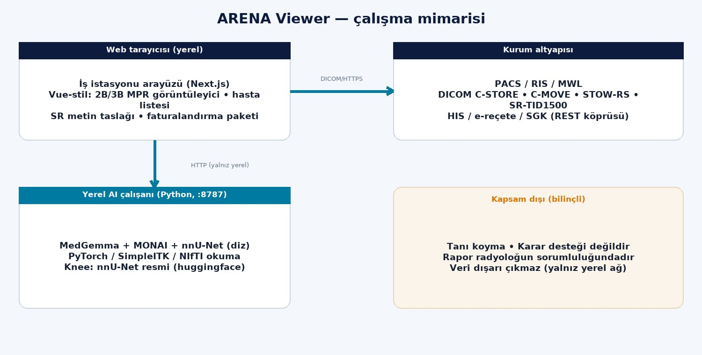
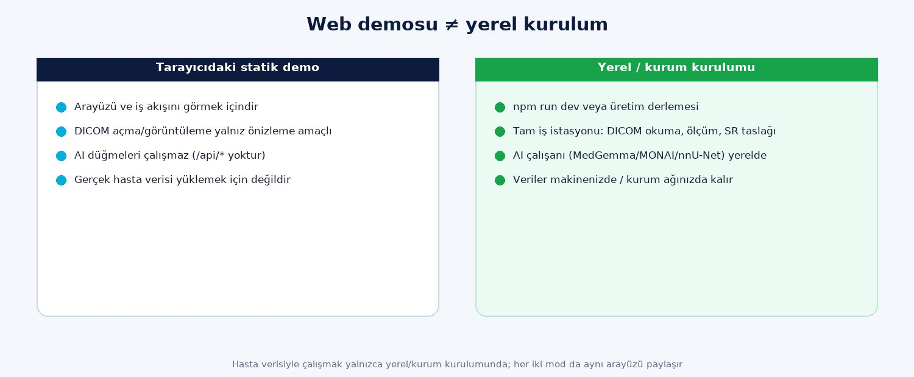
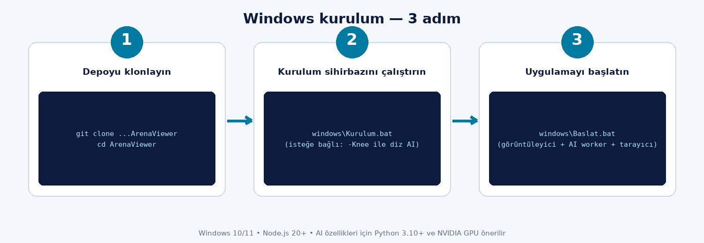
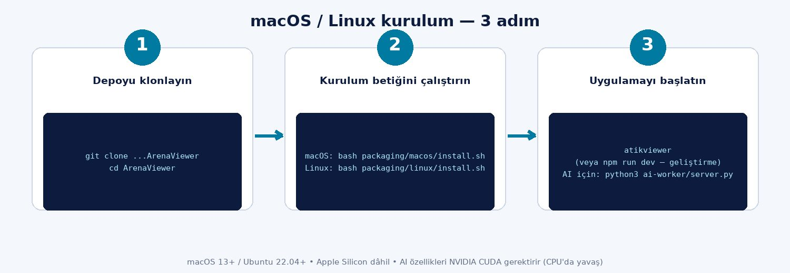
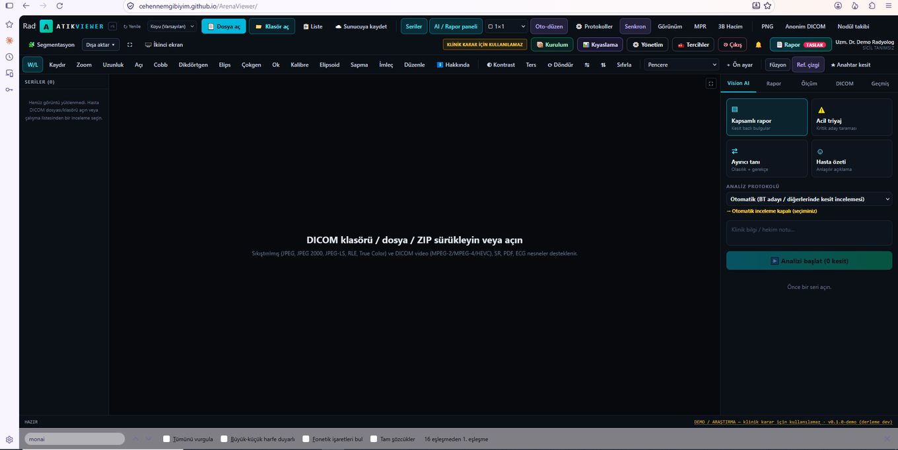
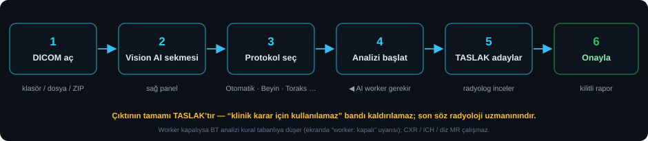
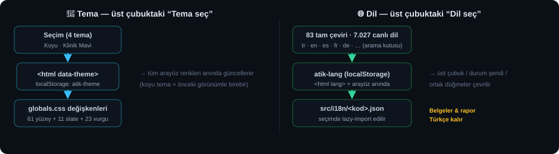

# ATIKVIEWER — Görsel Anlatım (ekran ekran, adım adım)

> **Kapsam:** İlk açılıştan rapor onayına kadar her işlemin ne yaptığı, hangi sırayla yapıldığı ve
> web demosunda mı yoksa yerel kurulumda mı çalıştığı — **görselli** anlatım.
> Terim karşılıkları: **AI worker** = yapay zekâ modellerini yerelde koşturan Python süreci (`127.0.0.1:8787`);
> **görüntüleyici** = tarayıcıda çalışan Next.js arayüzü; **PACS** = hastane görüntü arşivi.
>
> **Boyut notu (depoya saygı):** Bu kılavuzdaki görseller sıkıştırılmış JPEG (~52–84 KB) ve elle
> çizilmiş SVG vektör şemaları (~3–6 KB) dır; toplam ≈ 600 KB. Görsel sıkıştırma kuralı:
> `python3 -c "from PIL import Image; im=Image.open('kaynak.png'); im.convert('RGB').save('hedef.jpg',quality=82,optimize=True)"`.
> Dış kaynaklı / lisanslı kılavuzların kopyaları depoya **konmaz** — yalnız özgün, basitleştirilmiş
> şemalar kullanılır (bkz. §9).
>
> **PDF:** Tag (`v*`) push'unda `.github/workflows/docs-pdf.yml` bu belgeyi (`MENU_KILAVUZU`, `SSS`, `KURULUM_VE_KULLANIM` ile birlikte) Noto Sans ile XeLaTeX üzerinden PDF'e çevirir ve **Release** asset'i olarak yayımlar. PDF'ler depoya alınmaz.

**Dil notu:** Gövde Türkçedir; UI ekran görüntülerindeki etiketler arayüzle birebir aynıdır.
> Arayüz dilini değiştirmek için §7.3'e bakın. Uluslararası PDF dağıtımı gerekiyorsa en temiz yol,
> bu belgeyi `pandoc --pdf-engine=xelatex -V mainfont="Noto Sans" docs/GORSEL_ANLATIM.md -o GORSEL_ANLATIM-tr.pdf`
> ile üretip dili `src/i18n/*.json` anahtarlarıyla çoğaltmaktır; **kaynağı SVG + JPEG** tuttuğu için
> PDF üretimi de birkaç saniye sürer ve depo şişmez (PDF'i depoya eklemeyin — Release olarak dağıtın).

---

## İçindekiler

1. [Önce şunu anlayın: iki süreç ve tek kural](#1--önce-şunu-anlayın-iki-süreç-ve-tek-kural)
2. [Hangi ortamda çalışıyorsunuz? (web demo vs Windows vs macOS/Linux vs Docker)](#2--hangi-ortamda-çalışıyorsunuz)
3. [İlk açılış — işletim sistemine göre](#3--ilk-açılış)
4. [Bir çalışmayı uçtan uca açmak (tık tık)](#4--bir-çalışmayı-uçtan-uca-açmak)
5. [Vision AI ile analiz — karar ağacı](#5--vision-ai-ile-analiz--karar-ağacı)
6. [Rapor: TASLAK → düzenle → onayla → dışa aktarım](#6--rapor-taslak--düzenle--onayla--dışa-aktarım)
7. [Tema, dil ve erişilebilirlik](#7--tema-dil-ve-erişilebilirlik)
8. [Sık sorulanlar (hızlı referans)](#8--sık-sorulanlar)
9. [Görsel envanteri ve boyutları](#9--görsel-envanteri-ve-boyutları)
10. [Bu kılavuzu güncel tutmak](#10--bu-kılavuzu-güncel-tutmak)

---

## 1 · Önce şunu anlayın: iki süreç ve tek kural

ATIKVIEWER tek bir program değildir: **iki süreç** konuşur, **tek kural** geçerli.



**Tek kural:** *Görüntüleyiciye yüklediğiniz hasta verisini hiçbir yere göndermez.* AI worker yalnızca
`127.0.0.1`'de dinler; ikincisi kapalıysa AI özellikleri sessizce "kural tabanlı" yedeğe düşer —
uyarıyı ekranda görürsünüz, veriniz yine de makinenizden çıkmaz.

| Süreç | Ne yapar | Nasıl başlatılır | Port |
|---|---|---|---|
| **Görüntüleyici** (Next.js) | Arayüz, DICOM okuma/MPR, ölçüm, rapor, STOW-RS istemcisi, `/api/*` uçları | `npm run dev` (geliştirme) · `npm run build && npm start` (üretim) · Windows: `windows\Baslat.bat` · Docker: `docker compose up -d` | 3000 |
| **AI worker** (Python) | CXR (ONNX, 28 MB) · MONAI akciğer nodülü (≈84 MB) · BT beyin kanama adayı (ICH, ≈147 MB) · diz MR nnU-Net (≈1,6 GB, opsiyonel) | `python ai-worker/server.py` · Windows: `windows\Baslat.bat` ikisini birden açar · Docker: `docker compose --profile ai up -d` | **8787** |

**Worker kapalıyken ne olur?** (bu tablo kılavuzun en önemli tablosudur)

| Özellik | Worker var | Worker yok |
|---|---|---|
| DICOM açma / pan / zoom / W-L / ölçüm / MPR / 3B | ✅ tam | ✅ tam (AI gerekmez) |
| Rapor onayı / PDF / SR dışa aktarım | ✅ | ✅ (DB varsa) |
| BT toraks **nodül adayı** (MONAI) | ✅ | ❌ "worker: kapalı" uyarısı + kural tabanlı yedek |
| **BT beyin kanama adayı** (ICH 147 MB) | ✅ | ❌ çalışmaz |
| **Göğüs grafisi (CXR) skoru** (28 MB ONNX) | ✅ | ❌ çalışmaz |
| **Diz MR segmentasyonu** (1,6 GB) | ✅ (kurulduysa) | ❌ çalışmaz |
| Vision AI sekmesindeki "Tümünü AI ile analiz et" | ✅ | ❌ (buton sonuç üretmez; uyarı verir) |

Worker'ın sağlıklı olduğunu **iki yerden** anlayın: terminal satırı (`ATIKVIEWER AI worker: http://127.0.0.1:8787` + `Model yüklendi.`) ve `/paketler` sayfasındaki AI durumu kartı. Ana şeritteki `HAZIR` ifadesi **görüntüleyicinin** durumudur — worker'ı anlattığı anlamına **gelmez**.

---

## 2 · Hangi ortamda çalışıyorsunuz?



| | GitHub Pages (web demo) | Windows yerel | macOS / Linux yerel | Docker (kurum) |
|---|---|---|---|---|
| Adres / komut | `https://cehennemgibiyim.github.io/ArenaViewer/` | `windows\Kurulum.bat` → `windows\Baslat.bat` | `packaging/macos|linux/install.sh` | `docker compose --profile ai up -d` |
| Arayüzü görme | ✅ | ✅ | ✅ | ✅ |
| DICOM görüntüleme (önizleme) | ✅ | ✅ tam | ✅ tam | ✅ tam |
| AI analizi | ❌ (`/api/*` yok) | ✅ | ✅ | ✅ |
| PostgreSQL + sunucuya kaydetme | ❌ | opsiyonel (`PostgreSQL 16+`) | opsiyonel | ✅ (compose'da otomatik) |
| Çalışma listesi / denetim kaydı / STOW-RS | ❌ | DB varsa | DB varsa | ✅ |
| Gerçek hasta verisi | ❌ kullanmayın | ✅ | ✅ | ✅ (kurum ağında) |
| Kullanım amacı | tanıtım + eğitim | tek hekim / nöbet | geliştirici / Linux sunucu | hastane, PACS entegre |

**Özet karar ağacı:** Arayüzü tanımak istiyorsanız → **web demosu**. Kendi hasta verinizle çalışacaksanız → **yerel kurulum**. PACS/RIS ile entegre, çok kullanıcılı olacaksanız → **Docker + kurum**.

---

## 3 · İlk açılış

### 3.1 Web demosu (hiçbir kurulum yok, 30 saniye)

1. `cehennemgibiyim.github.io/ArenaViewer/` adresini açın.
2. Kırmızı `DEMO` etiketini görün — "klinik karar için kullanılamaz" uyarısı zaten sabittir.
3. `Dosyalar` düğmesine basın → örnek DICOM seçin (kendi verinizi web demosuna **yüklemeyin**).
4. Arayüz gezinilebilir; AI düğmeleri çalışmaz. Menülerin ne yaptığı: **[MENU_KILAVUZU](MENU_KILAVUZU.md)**.

### 3.2 Windows (hekimin makinesi)



1. Depoyu indirin: `Code → Download ZIP` → açın (örn. `C:\Users\<ad>\Downloads\ArenaViewer-main`).
2. **Kurulum:** `windows\Kurulum.bat` çift tıklayın. Node 22+, Python 3.11+, `.venv`, bağımlılıklar, `.env` (kendi `DATABASE_URL`'iniz yoksa SQLite/demo mod) ve AI modelleri iner (~350 MB; `-Knee` eklerseniz +1,6 GB).
3. **Başlat:** `windows\Baslat.bat` → AI worker + web arayüzü açılır, tarayıcı otomatik açılır (`http://127.0.0.1:3000`).
4. İlk açılışta `/giris` ekranında **demo hekim** hesabıyla `gir` komutu görünür (kurulum sonu konsolunda yazar; kurumsal kurulumda kendi hesaplarınız).
5. Sorun çıkarsa: **[WINDOWS_KURULUM §6](WINDOWS_KURULUM.md)** sık hatalar tablosu — en sıkı sorun `ExecutionPolicy`, port 3000/8787 doluluğu ve eksik VC++ redistributable'dır.

### 3.3 macOS / Linux



```bash
git clone <depo> && cd ArenaViewer
bash packaging/macos/install.sh    # veya packaging/linux/install.sh
python ai-worker/server.py &       # AI worker (ayrı terminal)
npm run dev                        # veya üretime: npm run build && npm start
```

### 3.4 Docker (kurum)

```bash
docker compose --profile ai up -d     # db (postgres:16) + web + ai-worker
docker compose logs -f ai-worker      # "Model yüklendi." satırını bekleyin
# Kurum PACS'ına bağlanmak için .env: PACS_AE_TITLE / PACS_HOST / PACS_PORT (bkz. docs/PACS_ENTEGRASYON.md)
```

---

## 4 · Bir çalışmayı uçtan uca açmak



Sürükle-bırak çalışır: klasörü / dosyaları / ZIP'i pencerenin üstüne bırakın. Adım adım:

| # | Yapacağınız | Nerede | Ne olur |
|---|---|---|---|
| 1 | `Dosyalar` veya `Klasör` düğmesi ya da sürükle-bırak | Üst çubuk 1 | DCM ayrıştırılır; ilerleme kartı çıkar (`x / toplam`); iptal edilebilir |
| 2 | Seri seç | Sol `SERİLER` paneli | Aksiyel/sagittal/koronal dizi listelenir; mod/boyuta göre gruplanır |
| 3 | Pencere/seviye (W/L) sürükle ya da ön ayar | Görüntü üstündeki `Pencere ön ayarı` + kaydır | CT: beyin/akciğer/kemik… hazır W/L'ler. MR'da elle ayar |
| 4 | Cetvel / açı / Cobb / çokgen | Araç çubuğu (klavye: `M` ölçüm araçları) | `U` uzunluk · `K` anahtar kesit · `V` ROI · `Esc` imlece dön |
| 5 | Aynı anda 2×2 görünüm | `Izgara düzeni` düğmeleri | `2x2`, `1x2` vb.; `Paneller arası kesit senkronu` açıkken kaydırınca kilitli |
| 6 | MPR | `Çok düzlemli yeniden kesit` → sekmeler Aksiyel/Koronal/Sagital/MIP | W/L ve yakınlaştırma MPR'a da uygulanır |
| 7 | 3B hacim (WebGL2) | `3B` düğmesi | Yüzen hacim penceresi; fareyle döndür / tekerlekle kes |
| 8 | Anahtar kesit | araç çubuğu `K` veya `★` düğmesi | Raporun "anahtar kesitler" bölümüne eklenir |
| 9 | Not | sağ panel `Ölçüm` → `Notlar` | Sarı ok + serbest metin; DICOM SR'ye yazılır |
| 10 | Sunucuya kaydet | `☁ Sunucuya kaydet` | AES-256-GCM ile `studies` tablosu + PACS'a STOW-RS (DB varsa) |
| 11 | Rapor | sağ panel `Rapor` → `📄 Raporu aç` | Şablon seçin (Kapsamlı/Acil triyaj/Ayırıcı tanı/Hasta özeti) |
| 12 | Onayla → PDF | `Rapor` sekmesi → `Onayla` → `🖨 Aç / yazdır` | Rapor kilitlenir (hash'li), Geçmiş sekmesine düşer |

Ayrıntı ve her aracın tam listesi: **[MENU_KILAVUZU](MENU_KILAVUZU.md) §4–§12**.

---

## 5 · Vision AI ile analiz — karar ağacı



**1. Worker çalışıyor mu?** Yukarıdaki tabloya bakın — çalışmıyorsa AI kodu zaten kural tabanlıya düşer.

**2. Doğru protokolü seçin** (sağ panel → `Vision AI` → `Analiz protokolü`):

| Protokol | Ne yapar | Motor |
|---|---|---|
| `Otomatik` | Modalite + içerikten tahmin: BT beyin → ICH, BT toraks → nodül, grafi → CXR | Worker |
| `Tüm karelerde görüntü ölçümü` | Hounsfield dağılımı, satürasyon, infiltrat kabaca | Kural tabanlı (+worker) |
| `BT Beyin — kanama adayı` | 147 MB ICH modeli; kesit başına risk skoru; eşiği aşan kesitler TASLAK listede | Worker (ICH) |
| `BT Toraks — nodül adayı` | MONAI bundle; nodül adayı kutuları + ortalama HU | Worker (MONAI) |
| `İncelemeyi kapat` | AI tamamen devre dışı | — |

**3. `Analizi başlat`**'a basın — işlem düğmede yazar (örn. "Analizi başlat (96 kesit)"). Uzun sürerse
`İptal` sunulur; kaç kesit kaldığı ilerlemede görünür.

**4. Sonuçlar `TASLAK` listesidir** — her aday kesit, güven skoru ve kısa gerekçeyle gelir. **Hiçbirini
rapor yazmadan kabul etmiş sayılmazsınız**; incelemediğiniz aday "kırmızı çöpe" atılmalı (listede ✗) ya
da elle düzeltilmelidir. Rapor onayının hukuki sorumluluğu radyoloji uzmanındadır.

**5. Tüm serileri tek seferde:** `Tüm yüklenen serileri birlikte AI ile analiz et` düğmesi yüklenen her
seriyi sırayla işler; sonuç her seri için ayrı TASLAK üretir.

**6. Gölge mod:** `NEXT_PUBLIC_AI_SHADOW_MODE=true` ile açılırsa AI adayları ne rapora ne ekrana düşer;
`shadow_findings` tablosuna yazılır. Yeni/ince ayarlı modeli klinik akışı bozmadan doğrulamak içindir.
Özet: `/api/shadow/summary`.

**Kalça/ekstremite kırığı, BT kolon polip, RSNA pnömoni 2. skoru** gibi adaylar hâlâ *kod yok* adaydır;
`/kiyaslama` sayfasında ve [KURULUM_VE_KULLANIM §7](KURULUM_VE_KULLANIM.md)'de izleyin.

---

## 6 · Rapor: TASLAK → düzenle → onayla → dışa aktarım

1. Sağ panel **Rapor** sekmesi → `📄 Raporu aç`.
2. Taslak gövde AI adayları + ölçümler + anahtar kesitlerle **önceden doldurulur**; her bulgu blokunu gözden geçirin, imla/hekim tercihine göre düzenleyin.
3. `Anahtar kesit ekle (K)` ile ekran görüntüsünü raporun içine bırakın (önerilen: yumuşak doku + kemik penceresi çiftleri).
4. `Onayla` → rapor **değiştirilemez** duruma gelir (hash'lenir, denetim kaydına yazılır). Yanlışsa yeni sürüm oluşturun (`/api/report-version`).
5. Dışa aktarım: `🖨 Aç / yazdır` (PDF) · `DICOM SR` (structured report, TTDR-1500 uyumlu) · `Hasta mektubu` (yalın dilde özet) · HL7 `ORU^R01` (HIS'e gönderim).
6. `Geçmiş` sekmesi onaylı tüm sürümleri oynatır (kim, ne zaman, hangi hash).

---

## 7 · Tema, dil ve erişilebilirlik

### 7.1 Tema neden "hiçbir şey değiştirmiyordu" — ve artık değiştiriyor

Önceki sürümde tema seçicisi yalnız CSS'te tanımlanmış ama hiçbir bileşenin kullanmadığı birkaç değişkeni
değiştiriyordu; bu yüzden `Açık Tema` seçseniz de arayüz karanlık kalıyordu. **2026-11-26 düzeltmesiyle**
tüm yüzey/kenarlık/soluk metin renkleri `globals.css` içindeki 61 yapısal değişken + 11 slate basamağı +
23 yumuşak vurgu tonuna (açık temada AA'ya yakın koyulaştırılmış) bağlandı; koyu tema önceki
görünümle **birebir** aynıdır, Açık/Klinik Mavi/Yüksek Kontrast artık gerçekten uygulanır.
Bilinen sınırlar: çok soluk etiketler (`--sl900/950`, parlak aksan üzerine gelenler) bilinçli olarak parlaktır;
tek doğrulama ortamı statik kontrast denetimidir — tarayıcıda görsel son geçiş Windows makinesinde yapılmalıdır.



| Seçim (üst çubuk → `Tema seç`) | Etki |
|---|---|
| **Koyu (Varsayılan)** | Özgün karanlık tema — nötür mavi-gri zeminler, cyan vurgular |
| **Klinik Mavi** | Daha doygun mavi zemin — nöbet odası parlaklığı için |
| **Açık Tema** | Işık ortamı / erişilebilirlik önceliği; metin kontrastı ≈18:1 |
| **Yüksek Kontrast** | Siyah zemin + beyaz metin/kenarlık; ikincil metinleri AA üstüne çıkarır |

Seçim `localStorage` anahtarında (`atik-theme`) saklanır ve açılışta geri uygulanır. **DICOM görüntüsü
hiçbir temadan etkilenmez** (piksel verisi siyahtır; yalnız krom değişir).

### 7.2 Erişilebilirlik

- `Yüksek kontrast` teması ikincil metinleri okunabilir yapar; `Skip link` (Tab'da ilk odak “İçeriğe geç”) mevcuttur.
- Klavye: `Tab` sırayla gezinti · `Enter/Space` etkinleştir · `Esc` modal kapat · görüntü üstünde `U/K/V` ölçüm.
- Yazdırılabilir rapor (`#print-root`) her zaman siyah-beyaz okunur.

### 7.3 Dil — 83 tam çeviri + seçicide 7.027 yaşayan dilin tümü

- Üst çubuktaki **🌐 `Dil seç`** düğmesi → arama kutusu (yazın: "turk", "germ", "日本"…) → dil.
- **Katman 1 — Çevirisi hazır 83 dil kayıtlıdır:** `tr, en, es, fr, de, it, pt, nl, pl, ru, uk, cs, sv, ro, hu, bg, ar, he, hi, zh, ja, ko, id, th, bn, ur, fa, ta, te, mr, gu, kn, ml, pa, or, vi, ms, fil, ceb, da, fi, el, sk, sl, et, lv, lt, sr, hr, bs, mk, sq, hy, ka, az, kk, ky, uz, mn, sw, ha, yo, ig, zu, af, am, ne, si, my, km, lo, rw, so, mg, ht, ca, eu, gl, tuk, tat, uig, bak, crh` — dünyanın en çok konuşulan dillerini (konuşucuların ~%90'ı) kapsar.
- **Katman 2 — ISO 639-3 canlı dillerinin tümü (7.027) listelenir:** 2+ harf yazınca görünür; çevirisi olmayan dili **seçebilirsiniz** — arayüz **İngilizce yedeğiyle** açılır ve satırda "EN UI" rozeti gösterilir. Katalog `src/i18n/catalog.json`'dur (ISO 639-3 / SIL verisi; `npm run i18n:catalog` ile yeniden üretilir); seçici açıldığında bir kez (~194 KB) lazy yüklenir, başlangıç paketini şişirmez.
- Paketler `src/i18n/<kod>.json` dosyalarında durur; **yalnız seçtiğiniz dil indirilir** (lazy-load) — ilk açılış yavaşlamaz, paket boyutu ~2 KB/dil. Tamamının diski ~14 MB'dir ama hiç kimse tümünü indirmez.
- **Yedek:** eksik anahtar İngilizce'ye düşer; o da yoksa anahtarın kendisi (CI yakalar).
- Kapsam: üst çubuk, durum şeridi, ortak düğmeler ve Tema/Dil seçicileri çevrilir. **Belgeler (`docs/*.md`), AI rapor gövdesi ve modal içerikleri henüz yalnız Türkçe'dir.** `ar`/`he` seçildiğinde `lang` öznitelik doğrudur; yerleşim LTR kalır (RTL görsel denetimi ayrı iştir).
- **Yeni dil eklemek tek komut:** `npm run i18n:new -- <kod> "<Native>" "<English>"` → `src/i18n/<kod>.json` iskeletini ve `src/lib/i18n.ts` LANGUAGES + registry kayıtlarını otomatik ekler; sonra anahtarlar çevrilir → `npm run test:i18n` PASS. Ayrıntı: [CEVIRI_KATKI.md](CEVIRI_KATKI.md). Katkılar PR ile.
- **Dürüst sınır:** 7.027 dilin çevirisi **hiçbiri makine çevirisiyle doldurulmaz** — her biri anlamlı, gözden geçirilmiş çeviri + CI paritesiyle girer; bu da zaman/katkı ister. "Tüm diller listede, 83'ü tam çeviri" bugünkü durumdur; "tüm diller tam çeviri" kelamı henüz geçerli değildir ve katkı çağrısı açıktır.

---

## 8 · Sık sorulanlar

Tam liste: **[SSS.md](SSS.md)** · uygulama içi karşılığı: **`/yardim`** sayfası. En kritik üçü:

**S: Yapay zekâ otomatik algılar mı; işçiyi ayrıca çalıştırmam gerekir mi?** — Evet, gerekir;
AI kendiliğinden devreye girmez. `python ai-worker/server.py` (veya `windows\Baslat.bat`) kullanıcı eylemiyle
başlar; görüntü sunucuda çıkarım üretmez. Bkz. §1 ve §5.

**S: Kandırma payı ne kadar?** — Hiçbir model çıktısı "doğru" sayılmaz; TASLAK etiketlidir,
rapor onayı radyolodundur. ICH/nodül modelleri **tanı koymaz**; şüpheli kesiti işaretler.

**S: Boyut fiy/rasyosu nedir?** — Worker koyuşu: CXR 28 MB · MONAI 84 MB · ICH 147 MB · diz MR 1,6 GB.

---

## 9 · Görsel envanteri ve boyutları

| Dosya | İçerik | Tür | Boyut |
|---|---|---|---|
| `ekran-ana-arayuz.jpg` | Ana arayüz (hekim ekranı, hasta verisi anonim) | JPEG | ~64 KB |
| `ekran-menu-haritasi.jpg` | 11 numaralı bölge haritası | JPEG | ~74 KB |
| `diyagram-mimari.jpg` | İki süreç + kurum PACS | JPEG | ~84 KB |
| `diyagram-web-yerel-farki.jpg` | Web demosu vs yerel kurulum | JPEG | ~64 KB |
| `diyagram-windows-kurulum.jpg` | Windows adım adım | JPEG | ~52 KB |
| `diyagram-macos-linux-kurulum.jpg` | macOS / Linux adımları | JPEG | ~56 KB |
| `diyagram-sorun-giderme.jpg` | Sorun giderme ağacı | JPEG | ~76 KB |
| `diyagram-yol-haritasi.jpg` | Sürüm yol haritası | JPEG | ~72 KB |
| `sema-ai-akisi.svg` | 6 adımlı analiz akışı (§5) | SVG | ~5 KB |
| `sema-tema-dil.svg` | Tema + dil mekanizması (§7) | SVG | ~4 KB |
| `sema-resimli-anlatim.svg` | Uygulama içi resimli anlatımın okuma akışı + ortam rozetleri (`/resimlianlatim`) | SVG | ~3 KB |

Toplam ≈ 653 KB. Bu görsellerin tamamı `public/kilavuz/` altına **birebir** kopyalanır ve
uygulama içi kılavuz (`/resimlianlatim`) oradan okur; iki kopyanın ayrışması
`tests/guide-story.test.ts` tarafından yakalanır. **PDF/HTML dağıtımı:** bu dosyalar göreli yollarla referanslanır; `pandoc` ile PDF,
`mkdocs`/`docusaurus` ile HTML üretilebilir. PDF'i depoya eklemeyin — **Release asset** olarak bırakın.
Dış kaynaklı / lisanslı PDF'ler (örneğin Model Card'lar, RSNA kılavuzları) depoya alınmaz; yalnız
bağlantıları [MENU_KILAVUZU](MENU_KILAVUZU.md) / [SSS](SSS.md)'de verilir.

---

## 10 · Bu kılavuzu güncel tutmak

Arayüzde **her yeni düğme, sekme, sayfa veya süreç** değiştirildiğinde şu üçü birlikte güncellenir
(zorunlu; PR kontrol listesinde işaretlidir):

1. **[MENU_KILAVUZU.md](MENU_KILAVUZU.md)** — düğme tablosu/haritası satırı,
2. **Bu belgede** §4–§7 ilgili adımı (gerekirse görsel),
3. **Dil paketleri** — yeni görünen tüm metinler `src/i18n/*.json`'a **83 dilde** eklenir ve
   `npm run test:i18n` çalıştırılır (CI da bunu zorlar). Yeni bir dil eklendiyse katalog
   denetimi (`catalog.json` içinde yaşayan ISO dili) ve kılavuzdaki sayı notları
   [CEVIRI_KATKI.md](CEVIRI_KATKI.md)'ye göre güncellenir.

Görüntü yenilemek gerekirse sıkıştırmayı §Başındaki kuralla yapın (JPEG q82). Kılavuz dışı bırakılan
istisnalar: OS şeritleri, hasta adı/yüz gibi PII içeren görüntüler — **asla** eklenmez.

Kurallar ve PR kontrol listesi: **[KILAVUZ_BAKIMI.md](KILAVUZ_BAKIMI.md)** · [../CONTRIBUTING.md](../CONTRIBUTING.md)
