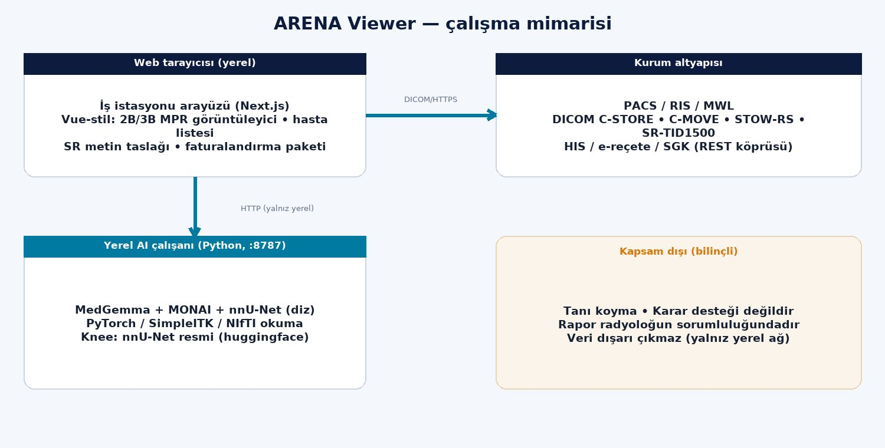
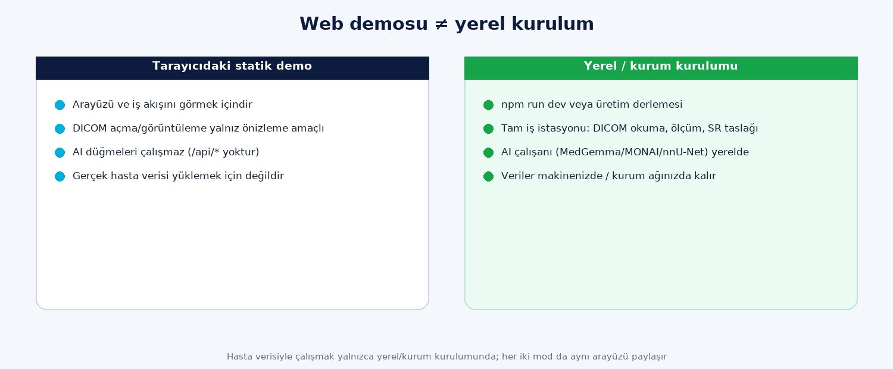
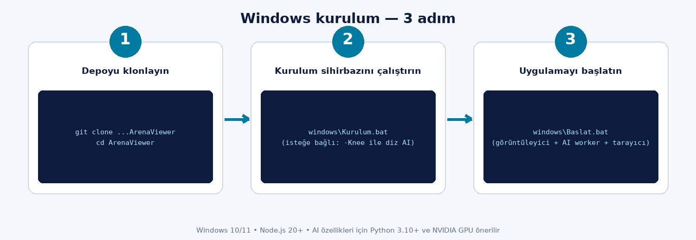
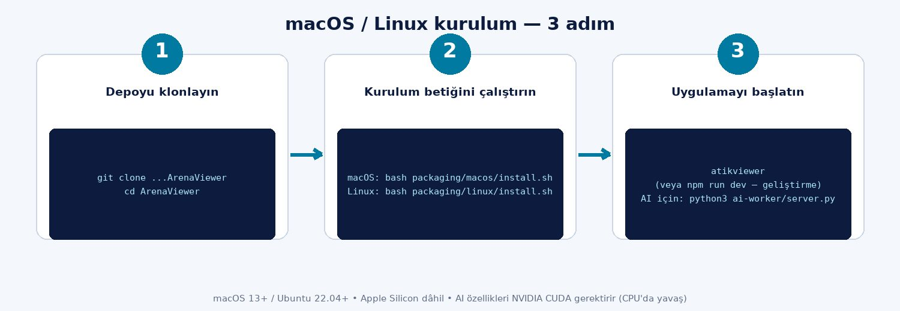
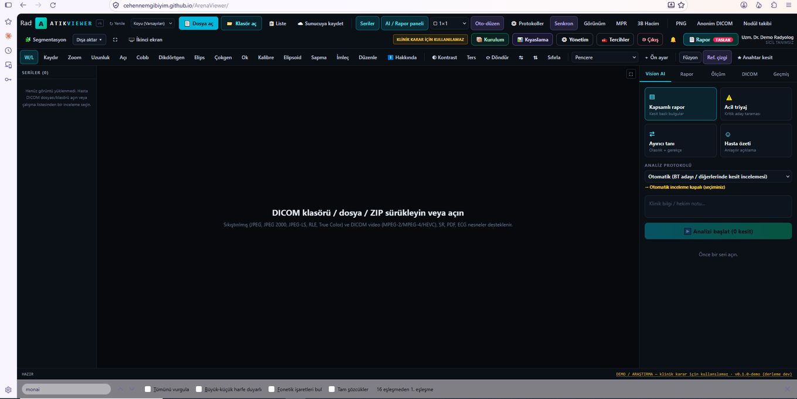
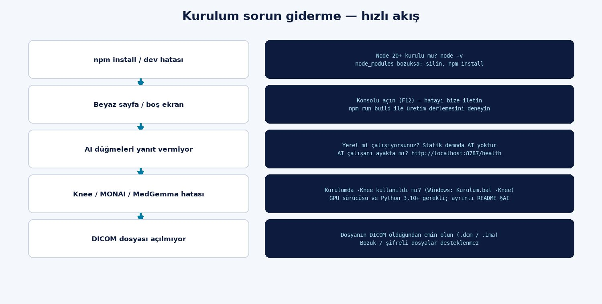
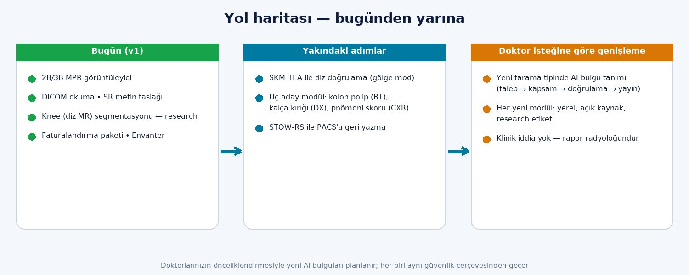

# ARENA Viewer — Kurulum ve Kullanım Kılavuzu

> Bu kılavuz **web tarayıcısındaki statik demoyu** ve **Windows · macOS · Linux** yerel kurulumunu
> kapsar. Her adım ücretsizdir; abonelik, dış API anahtarı veya ücretli servis gerekmez.
> Hasta verisi ve yapay zekâ çıkarımı yalnızca **sizin makinenizde / kurum ağınızda** çalışır.
>
> ⚠️ **Klinik karar için kullanılamaz.** Tüm yapay zekâ çıktıları araştırma (research) etiketli
> taslaklardır; tanı koyma yetkisi ve sorumluluğu radyoloji uzmanındadır.

**🎥 Videolu anlatım (≈3,5 dk, Türkçe, 2,8 MB):** [`media/kurulum-kullanim.mp4`](media/kurulum-kullanim.mp4)
— aynı adımları sesli olarak özetler. Sesi açık oynatın; slaytlardaki metinler okunaklıdır.
Depoya bilerek küçük tutulmuştur (1280×720, 25 fps, mono 64 kbps ses).



---

## İçindekiler

1. [ARENA Viewer nedir?](#1-arena-viewer-nedir)
2. [Web demosu mu, yerel kurulum mu?](#2-web-demosu-mu-yerel-kurulum-mu)
3. [Kurulum — işletim sistemine göre](#3-kurulum--işletim-sistemine-göre)
   - [3.1 Windows](#31-windows)
   - [3.2 macOS](#32-macos)
   - [3.3 Linux (Debian / Ubuntu / Fedora / Arch)](#33-linux-debian--ubuntu--fedora--arch)
   - [3.4 Docker (her işletim sistemi)](#34-docker-her-işletim-sistemi)
   - [3.5 PostgreSQL gerekli mi?](#35-postgresql-gerekli-mi)
4. [İlk çalıştırma — arayüz turu](#4-ilk-çalıştırma--arayüz-turu)
5. [Yapay zekâ modülleri (yerel)](#5-yapay-zekâ-modülleri-yerel)
6. [Sorun giderme](#6-sorun-giderme)
7. [Doktor isteğine göre genişleme yolu](#7-doktor-isteğine-göre-genişleme-yolu)
8. [Depo boyutu ve dosya haritası](#8-depo-boyutu-ve-dosya-haritası)

---

## 1. ARENA Viewer nedir?

Açık kaynaklı, yerelde çalışan bir **radyoloji görüntüleme ve raporlama iş istasyonudur**:

- 2B/3B MPR görüntüleyici (sekanslı MR, BT, DX, akciğer grafi ekranları)
- DICOM okuma/yazma, ölçümler (cetvel, ROI, RECIST), SR (TID1500) metin taslağı
- Yerel yapay zekâ hattı: göğüs grafisi skoru, DICOM SR/standart çıktılar, diz MR segmentasyonu (research)
- İş akışı: çalışma listesi, PACS (DICOMweb QIDO/WADO/STOW-RS), HBYS/RIS köprüsü, denetim kaydı
- Rapor sonrası: faturalandırma paketi, anonim DICOM kopyalama, hasta bilgilendirme mektubu

**Ne değildir:** tanı koyan bir sistem değildir; kapalı bir kara kutu değildir — kaynak kodu
açıktır, mantığı denetlenebilir; ve bakım/doğrulama sorumluluğunu radyoloji uzmanından almaz.

## 2. Web demosu mu, yerel kurulum mu?



| | Web demosu (GitHub Pages) | Yerel / kurum kurulumu |
|---|---|---|
| Adres | `https://cehennemgibiyim.github.io/ArenaViewer/` | `http://localhost:3000` (veya kurum sunucusu) |
| Sunucu/veritabanı | **Yok** — `/api/*` uçları kapalıdır | **Var** — tam iş istasyonu |
| Yapay zekâ düğmeleri | Çalışmaz (worker yoktur) | Çalışır (yerel ai-worker, `127.0.0.1:8787`) |
| Kullanım amacı | Arayüzü tanımak, eğitim/gösterim | Gerçek görüntü işleme ve raporlama |
| Hasta verisi | **Yüklenmemelidir** (oturumsuz, geçici) | Yalnız makinede/kurum ağında kalır |

Web demosu `main` dalına her itmede CI ile otomatik derlenip yayınlanır (`.github/workflows/pages.yml`).
Kimlik/rol kavramı demoda sabittir: tüm işlemler tek bir "Demo Radyolog" operatörüyle yapılır.

## 3. Kurulum — işletim sistemine göre

### Ortak ön koşullar

| Bileşen | Sürüm | Zorunlu mu? |
|---|---|---|
| Node.js | 22+ (`.nvmrc`) | **Evet** |
| npm | 10+ (Node ile gelir) | **Evet** |
| Git | 2.40+ | **Evet** |
| PostgreSQL | 16+ | Önerilir ([bkz. 3.5](#35-postgresql-gerekli-mi)) |
| Python | 3.11 – 3.14 | Yalnız yapay zekâ (ai-worker) için |
| NVIDIA sürücü + CUDA | sürücüyle gelen | Hayır; CPU'da da çalışır (yavaş) |

Depoyu klonlayın (tüm işletim sistemleri):

```bash
git clone https://github.com/CehennemGibiyim/ArenaViewer.git
cd ArenaViewer
```

### 3.1 Windows



En kısa yol **tek komuttur** (Windows 10/11, PowerShell):

```bat
windows\Kurulum.bat     :: önkoşul + AI paketleri + modeller + npm ci + .env
windows\Kurulum.bat -Knee    :: ek olarak diz MR segmentasyon modeli (~1,6 GB)
windows\Baslat.bat      :: AI worker (8787) + görüntüleyici (3000) + tarayıcı
windows\Dur.bat         :: çalışan süreçleri kapatır
```

PowerShell karşılıkları ve elle kurulum (CUDA, sık hatalar) için:
**[WINDOWS_KURULUM.md](WINDOWS_KURULUM.md)**.

### 3.2 macOS



```bash
bash packaging/macos/install.sh   # Intel ve Apple Silicon
```

Betik; Node 22 (yoksa Homebrew ile), `.env`, Drizzle şeması, üretim derlemesi ve
`/usr/local/bin/atikviewer` başlatıcısını kurar. Ön koşul: `xcode-select --install` ve Homebrew (önerilir).

Elle kurulum:

```bash
brew install node@22 git postgresql@16
cp .env.example .env          # DATABASE_URL'i düzenleyin
npm ci
npx drizzle-kit push --config=drizzle.config.ts
npm run dev                    # http://localhost:3000
```

Yapay zekâ (Apple Silicon'da CPU/MPS ile çalışır, yavaştır; NVIDIA GPU gerekmez):

```bash
python3 -m venv .venv
.venv/bin/pip install -r ai-worker/requirements.txt
.venv/bin/python ai-worker/setup_model.py    # akciğer ≈84 MB + beyin ≈147 MB
.venv/bin/python ai-worker/server.py         # 127.0.0.1:8787
```

### 3.3 Linux (Debian / Ubuntu / Fedora / Arch)

`bash packaging/linux/install.sh` — Node 22+, PostgreSQL, `.env`, şema, üretim derlemesi,
`~/.local/bin/atikviewer` başlatıcısı ve masaüstü kısayolunu kurar.

Elle kurulum (Ubuntu 22.04/24.04 örneği):

```bash
sudo apt update && sudo apt install -y git nodejs npm postgresql
# Node 22 yoksa: https://nodejs.org ya da nvm kullanın (apt'nin sürümü eski olabilir)
cp .env.example .env && npm ci
npx drizzle-kit push --config=drizzle.config.ts
npm run dev
```

GPU'lu çıkarım için dağıtımınıza uygun NVIDIA sürücüsünü kurun (`nvidia-smi` ile doğrulayın);
ai-worker kurulumu macOS ile aynıdır (`.venv/bin/python ai-worker/server.py`).

### 3.4 Docker (her işletim sistemi)

```bash
cp .env.example .env        # POSTGRES_PASSWORD ve DATA_ENCRYPTION_KEY doldurun
docker compose up --build -d          # tam iş istasyonu + PostgreSQL
docker compose --profile ai up -d     # + yerel derin AI servisi (ilk açılışta ~231 MB indirir)
```

Ardından `http://localhost:3000`; durum: `http://localhost:3000/api/health`.

### 3.5 PostgreSQL gerekli mi?

**Görüntüleyici, ölçüm ve yapay zekâ için gerekmez.** Veritabanı yoksa uygulama yine açılır ve
ai-worker analizi çalışır; yalnızca **kalıcı** özellikler çalışmaz: çalışma listesi, sunucuya
kaydetme, kayıtlı raporlar, denetim kaydı ve DICOMweb STOW-RS geri yazma.
SQLite desteklenmez; kalıcı kayıt için PostgreSQL 16+ önerilir, geçici/zarif düşüş için
veritabanısız kullanım yeterlidir. Docker yolunda şema ilk açılışta otomatik uygulanır.

## 4. İlk çalıştırma — arayüz turu

> **Hangi düğme neye yarar?** Tüm menülerin tek tek açıklaması ve numaralı ekran haritası:
> **[MENU_KILAVUZU.md](MENU_KILAVUZU.md)** (sürekli güncel tutulur — bkz. [KILAVUZ_BAKIMI.md](KILAVUZ_BAKIMI.md)).
> **Adım adım görselli anlatım:** web demosu / Windows / macOS-Linux / Docker farklarını, AI analiz karar
> ağacını ve tema/dil mekanizmasını **[GORSEL_ANLATIM.md](GORSEL_ANLATIM.md)** belgesinde ekran ekran bulursunuz.
> **En çok sorulan sorular:** [SSS.md](SSS.md) — worker'ı ayrıca başlatmak gerekir mi,
> AI kendiliğinden mi çalışır, GPU şart mı … (uygulama içindeki karşılığı: **`/yardim`** sayfası).
>
> 

- **Sol panel — SERİLER:** DICOM klasörünü, dosyayı ya da ZIP'i sürükleyip bırakın; sekanslar
  listelenir ve hasta anahtarı anonim gösterilir.
- **Merkez — 2B/3B görüntüleyici:** sekmeler `Görünüm · MPR · 3B Hacim`; tekerlek ile kesit,
  sağ-tuş sürükle ile pencere/parlaklık, `W/L` düğmeleriyle hazır pencereler (yumuşak doku, kemik, akciğer).
- **Ölçüm araç çubuğu:** Cetvel, Açı, Çokgen/Elips ROI, RECIST, Hounsfield profili; ölçüm tablosu
  dışa aktarılabilir.
- **Sağ panel — Vision AI · Rapor · Ölçüm · DICOM · Geçmiş:** AI analiz düğmeleri (BT toraks, akciğer
  grafisi, diz MR), rapor şablonu ve `Taslak` düğmesi burada. Her taslak
  **"KLİNİK KARAR İÇİN KULLANILAMAZ"** bandıyla uyarı taşır; rapor radyoloji uzmanına aittir.

## 5. Yapay zekâ modülleri (yerel)

Tümü **yerel** `ai-worker` sürecinde çalışır (`127.0.0.1:8787`); hiçbir görüntü kurum dışına çıkmaz.
Hepsi **research** etiketlidir; tanı/karar desteği iddiası yoktur.

| Modül | Girdi | Ağırlık | Kurulum |
|---|---|---|---|
| Akciğer grafi (CXR) skoru | PA/AC grafisi | 28 MB (depoda, Apache-2.0) | ek adım yok |
| BT toraks analizi (MONAI) | BT kesitleri | ~84 MB | `ai-worker/setup_model.py` |
| Beyin kanama (ICH) | BBT | ~147 MB (MIT/RSNA) | `ai-worker/setup_model.py` |
| Diz MR segmentasyonu (nnU-Net) | T2 sagittal diz MR | ~1,6 GB (MIT, `aagatti/nnunet_knee`) | `ai-worker/setup_knee_model.py` |

Sağlık denetimi: `curl http://127.0.0.1:8787/health` → `{"ok": true, ...}`.
Windows'ta tek tuş: `windows\Kurulum.bat -Knee` (diz modelini ayrıca indirir).

## 6. Sorun giderme



| Belirti | İlk bakılacak yer |
|---|---|
| `npm ci` / derleme hatası | `node -v` ≥ 22; `node_modules` bozuksa silin ve `npm ci` |
| Boş sayfa | F12 → Console; `npm run build` ile üretim derlemesini deneyin |
| AI düğmeleri yanıt vermiyor | worker ayakta mı? `curl http://127.0.0.1:8787/health` |
| "worker: kapalı" uyarısı | `python ai-worker/server.py` çalışıyor mu; BT analizi kural tabanlı motora düşer |
| Diz MR (Knee) hatası | `-Knee` ile kuruldu mu? CUDA/PyTorch sürümü; bkz. README §"Yerel Derin AI" |
| DICOM açılmıyor | dosya gerçekten DICOM mu (`.dcm`)? şifreli/bozuk dosyalar desteklenmez |
| Port 3000 dolu | `ATIKVIEWER_PORT=3001 npm run dev` (Linux/macOS) / `docker compose` port eşlemesini değiştirin |

Windows'a özgü sık hatalar (winget, torch boyutu, akıllı uygulama denetimi):
[WINDOWS_KURULUM.md §6](WINDOWS_KURULUM.md) ve gizlilik notları için [§7](WINDOWS_KURULUM.md).

## 7. Doktor isteğine göre genişleme yolu



ARENA Viewer'a yeni bir tarama tipinde yapay zekâ bulgusu eklenmesi **bilinçli bir süreçtir**:

1. **Talep:** bölüm sorumlusu/doktor, hedef bulguyu ve modaliteyi yazar (ör. "BT kolonda polip işaretle").
2. **Kapsam:** kırmızı çizgiler — açık kaynak model, yerelde çalışma, research etiketi, klinik iddia yok.
3. **Doğrulama:** bağımsız veriyle (tercihen gölge/ayna modunda) saha doğrulaması; sonuç docs'a dürüstçe işlenir.
4. **Yayın:** model kartı + lisans bildirimi + `ai-worker` hattına eklenir; modül, kullanıcıların
   önceliklendirdiği sırayla plana konur.

Bugün sıradaki adaylar: **kolon polip (BT)**, **kalça/kırık (DX)**, **akciğer grafisi pnömoni skoru (CXR)**.
Sıradaki büyük kilometre taşı: SKM-TEA ile diz MR doğrulaması (gölge mod) → STOW-RS ile PACS'a geri yazma.

## 8. Depo boyutu ve dosya haritası

Bu kılavuz **depoya yük bindirmeden** görsel ağırlıklıdır; tüm görseller JPEG (progressive, q≈80) ve video H.264/64 kbps'tir:

| Dosya | Boyut |
|---|---|
| `docs/img/ekran-ana-arayuz.jpg` (gerçek ekran görüntüsü, anonim) | 64 KB |
| `docs/img/ekran-menu-haritasi.jpg` (numaralı menü haritası) | 74 KB |
| `docs/img/diyagram-*.jpg` (6 adet, PIL ile üretildi) | ≈ 390 KB |
| `docs/media/kurulum-kullanim.mp4` (sesli anlatım, 1280×720) | 2.8 MB |
| **Toplam** | **≈ 3.3 MB** |

Görsel ve videonun kaynağı (üretim betikleri) depoya **eklenmemiştir**; içerik Markdown ve hazır
varlıklar olarak yeterlidir. MP4, standart oynatıcılarda (VLC, tarayıcı, GitHub dosya görünümü) açılır.

**Bağlantılı belgeler**

- [WINDOWS_KURULUM.md](WINDOWS_KURULUM.md) — Windows ayrıntılı kurulum, sık hatalar
- [MENU_KILAVUZU.md](MENU_KILAVUZU.md) — her düğme/menü tek tek (numaralı ekran haritasıyla)
- [GORSEL_ANLATIM.md](GORSEL_ANLATIM.md) — uçtan uca görselli kullanım (web · Windows · macOS/Linux · Docker); tema & dil
- [SSS.md](SSS.md) — sık sorulan sorular (uygulama içi: **`/yardim`**)
- [KILAVUZ_BAKIMI.md](KILAVUZ_BAKIMI.md) — kılavuzu her değişiklikle güncel tutma kuralı
- [OLLAMA.md](OLLAMA.md) · [GITHUB_YAYINLAMA.md](GITHUB_YAYINLAMA.md) · [YEDEK_VE_DR.md](YEDEK_VE_DR.md)
- [KLINIK_DOGRULAMA_PLANI.md](KLINIK_DOGRULAMA_PLANI.md) — SKM-TEA sırası ve gölge mod
- [RISK_YONETIMI.md](RISK_YONETIMI.md) — ISO 14971 risk dosyası
- README §"Yerel Derin AI" — worker API'leri, model yolları, `x-dims`/`x-elapsed-ms` başlıkları
