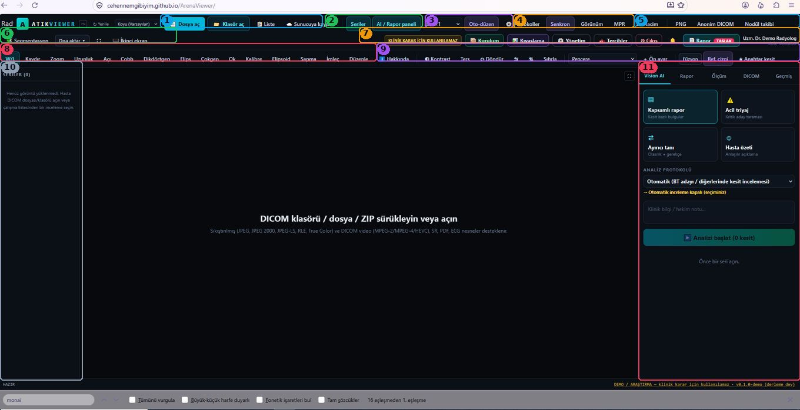

# Menü ve Araç Çubuğu Kılavuzu — ATIKVIEWER

> Bu belge, ana pencerenin **her düğmesini ve menüsünü** tek tek açıklar.
> Görseller [`ekran-menu-haritasi.jpg`](img/ekran-menu-haritasi.jpg) numaralı bölgelerine göre düzenlenmiştir;
> ham arayüz için [`ekran-ana-arayuz.jpg`](img/ekran-ana-arayuz.jpg).
> Tüm yapay zekâ çıktıları **research** etiketlidir; klinik karar radyoloji uzmanına aittir.
>
> ⚠️ Ekran görüntülerindeki en alttaki gri şerit **tarayıcının arama çubuğudur** (bulunan kelimeler),
> uygulama bileşeni değildir. Uygulamanın durum şeridi bir üstünde yer alır.

## Bu kılavuzu güncel tutmak zorunludur

Arayüze **her eklenen/kaldırılan/yeniden adlandırılan düğme** bu belgede de güncellenir.
Bu kural yalnızca iyi niyet değil, **CI tarafından zorlanır**:

1. `tests/guide-coverage.test.ts` — bu üç kaynak dosyadaki her statik `title="…"` / `aria-label="…"` metninin
   ve her ekran-anchor'ünün bu belgede **birebir** geçmesini denetler. Güncelleme unutulursa `npm test` kırmızıya döner.
2. Yeni UI öğesi eklerken [`CONTRIBUTING.md`](../CONTRIBUTING.md) ve [PR şablonu](../.github/pull_request_template.md)
   kılavuz adımını hatırlatır.
3. Yeni özellik **aynı PR** içinde kılavuza işlenir; sonradan "dökmeye" bırakılmaz.

Ayrıntı: [docs/KILAVUZ_BAKIMI.md](KILAVUZ_BAKIMI.md).

---

> **Akış odaklı resimli anlatım:** adım adım uçtan uca kullanım (web demosu / Windows / macOS-Linux /
> Docker), AI analiz karar ağacı ve tema-dil mekanizması için **[GORSEL_ANLATIM.md](GORSEL_ANLATIM.md)**.
> Her düğme/sekmenin birebir açıklaması bu belgededir.

## İçindekiler

1. [Bölge 1 — Dosya & çalışma listesi](#bölge-1--dosya--çalışma-listesi)
2. [Bölge 2 — Seriler / AI-Rapor paneli](#bölge-2--seriler--ai-rapor-paneli)
3. [Bölge 3 — Izgara düzeni + Oto-düzen](#bölge-3--ızgara-düzeni--oto-düzen)
4. [Bölge 4 — Protokoller · Senkron · Görünüm](#bölge-4--protokoller--senkron--görünüm)
5. [Bölge 5 — MPR · 3B · PNG · Anonim DICOM · Nodül](#bölge-5--mpr--3b--png--anonim-dicom--nodül)
6. [Bölge 6 — Segmentasyon · Dışa aktar · Tam ekran · İkinci ekran](#bölge-6--segmentasyon--dışa-aktar--tam-ekran--i̇kinci-ekran)
7. [Bölge 7 — Uyarı bandı + Yönetim kısayolları](#bölge-7--uyarı-bandı--yönetim-kısayolları)
8. [Bölge 8 — Ölçüm araç çubuğu](#bölge-8--ölçüm-araç-çubuğu)
9. [Bölge 9 — Ön ayar · Füzyon · Ref.çizgi · Anahtar kesit](#bölge-9--ön-ayar--füzyon--refçizgi--anahtar-kesit)
10. [Bölge 10 — SERİLER paneli](#bölge-10--seriler-paneli)
11. [Bölge 11 — Vision AI / Rapor / Ölçüm / DICOM / Geçmiş](#bölge-11--vision-ai--rapor--ölçüm--dicom--geçmiş)
12. [Klavye kısayolları](#12-klavye-kısayolları) · [Fare](#13-fare-ve-tekerlek) · [Sayfalar](#14-sayfalar) · [Durum şeridi](#15-durum-şeridi)
16. [Sorun giderme](#16-sorun-giderme) · [İpucu referansı (birebir)](#17-i̇pucu-referansı-birebir)

---

## Bölge 1 — Dosya & çalışma listesi

| Düğme | İpucu / işlev |
|---|---|
| **A** logo + `ATIKVIEWER` | Marka bloğu; sağındaki numara derleme (build) anlamına gelir. |
| ↻ **Yenile** | `Arayüz paketini temiz biçimde yeniden yükle` — service worker/önbelleği atlayıp temiz yükleme yapar (`/?fresh=`). |
| **Tema seç** | `Koyu (Varsayılan)` · `Klinik Mavi` · `Açık Tema` · `Yüksek Kontrast`. Seçim `atik-theme` anahtarıyla saklanır ve **tüm arayüz renklerine uygulanır** (koyu = eski görünümle birebir; açık tema kontrast ≈18:1). DICOM pikseli temadan etkilenmez. Ayrıntı: [GORSEL_ANLATIM §7.1](GORSEL_ANLATIM.md). |
| **🌐 Dil seç** | `Dil seç` — 78'ten `tr` (varsayılan) `en es fr de it pt nl pl ru uk cs sv ro hu bg ar he hi zh ja ko id th` arasından arama ile seçim; paket `atik-lang` ile saklanır ve **lazy-import** edilir (yalnız seçilen dil indirilir, yedek `en`). Çevrilen katman = arayüz kromu; belgeler ve AI rapor gövdesi Türkçe kalır. Ayrıntı: [GORSEL_ANLATIM §7.3](GORSEL_ANLATIM.md). |
| **Dosya aç** | Çoklu DICOM/görsel dosyası seç (`.dcm`, `.jpg/.png`, video, PDF, SR). |
| **Klasör aç** | Tüm klasör hiyerarşisini yükler (`showDirectoryPicker`; FSAPI yoksa `webkitdirectory`). |
| 📋 **Liste** | `Çalışma listesi / PACS` — kayıtlı incelemeleri açar, PACS (QIDO/WADO) sorgusu başlatır. |
| ☁ **Sunucuya kaydet** | `Görüntüleri şifreli olarak sunucuya kaydet` — AES-256-GCM ile şifreleyip sunucuya yazar. |

Yükleme sırasında `Dosya yükleme ilerlemesi` rozeti görünür; takılırsa **Yüklemeyi iptal et** ile durdurun.

## Bölge 2 — Seriler / AI-Rapor paneli

| Düğme | İpucu |
|---|---|
| **Seriler** | `Seri listesini göster/gizle` — sol paneli aç/kapat. |
| **AI / Rapor paneli** | `AI, rapor, ölçüm ve DICOM panelini göster/gizle` — sağ paneli aç/kapat. |

## Bölge 3 — Izgara düzeni + Oto-düzen

| Denetim | İşlev |
|---|---|
| **Izgara düzeni** (`1×1 … 3×2`) | Paneller arası ızgara: `1×1 ▯`, `1×2`, `2×1`, `2×2`, `1×3`, `3×1`, `2×3`, `3×2`. Seçim sonrası otomatik düzen kapatılır. |
| **Oto-düzen** | `Hanging protocol: modaliteye göre otomatik düzen` — modalite/vücut bölgesine göre panelleri kendisi yerleştirir. |
| ⚙ **Protokoller** | `Özel Asma Protokolü Kuralları Editörü` — kural tabanlı özel hanging protocol tanımlar. |

## Bölge 4 — Protokoller · Senkron · Görünüm

| Düğme | İpucu |
|---|---|
| **Senkron** | `Paneller arası kesit senkronu (anatomik konuma göre)` — referans panelinin kesiti, aynı vücut konumundaki diğer panellere eşlenir. |
| **Görünüm** | `Görünüm kilidi (zoom + kaydır): ana panel ve önceki tetkik paneli aynı görünümü paylaşır; iki tarafta da değiştirilebilir` |

## Bölge 5 — MPR · 3B · PNG · Anonim DICOM · Nodül

| Düğme | İpucu |
|---|---|
| **MPR** | `Çok düzlemli yeniden kesit: aksiyel, koronal, sagittal ve MIP` |
| **3B Hacim** | `3B hacim görünümünü doğrudan aç (WebGL2 gerekir)` |
| **PNG** | `Geçerli kesiti PNG kaydet` |
| **Anonim DICOM** | `Anonimleştirilmiş DICOM (ZIP)` — hasta kimliğini temizleyerek dışa aktarır. |
| **Nodül takibi** | `Nodül takibi: zaman serisi, Lung-RADS özeti, hacim ikilenme süresi` |

## Bölge 6 — Segmentasyon · Dışa aktar · Tam ekran · İkinci ekran

| Düğme | İpucu |
|---|---|
| 🧩 **Segmentasyon** | `Segmentasyon editörü: fırça/silgi, eşik dolgusu, bölge büyütme, hacim (mL), DICOM SEG/RTSTRUCT` |
| **Dışa aktar ▾** | Anahtar kesitler ve ölçümlerle TIFF/PNG/DICOM SR çıktı menüsü (`ExportMenu`). |
| ⛶ | `Tam ekran` |
| 🖥 **İkinci ekran** | Aktif seriyi ikinci pencerede/ekranda canlı yayınla (WL/WW, kesit, zoom); `İkinci ekran yayınını durdur` ile kapatılır. |
| ● **Canlı XA/US** | `DICOMweb STOW-RS ile depolanmış çalışmaya gelen yeni XA/US örneklerini ~2 sn'de bir yokla ve açık seriye ekle. DIMSE C-STORE değildir; modalite/ağ geçidi STOW-RS POST kullanmalıdır.` (yalnız canlı kaynak tanımlıysa görünür) |

## Bölge 7 — Uyarı bandı + Yönetim kısayolları

| Öğe | İşlev |
|---|---|
| **KLİNİK KARAR İÇİN KULLANILAMAZ** | Kalıcı yasal/güvenlik bandı; her ekranda görünür. |
| 📦 **Kurulum** | `Windows · Linux · macOS kurulum paketleri ve dosya yolları` → [`/paketler`](/paketler) |
| 📊 **Kıyaslama** | Özellik kıyaslama tablosu ve aday modüller → [`/kiyaslama`](/kiyaslama) |
| ⚙ **Yönetim** | Kullanıcılar, roller, oturumlar/MFA, denetim kaydı, uyum listesi, AI performans → [`/yonetim`](/yonetim) |
| 🧰 **Tercihler** | `Kullanıcı tercihleri (düzen, pencere ön ayarı, otomatik protokol)` → [`/tercihler`](/tercihler) |
| ⎋ **Çıkış** | `Oturumu kapat` |
| 🔔 | Bildirim zili (kritik bulgu / sistem bildirimleri) |
| 📄 **Rapor TASLAK/ONAYLI** | Rapora gider; rozet `TASLAK` (kırmızı) veya `ONAYLI` (yeşil) gösterir. |
| **İsim / ünvan / sicil** | `Rapor imzasında görünecek hekim adı — düzenlemek için tıklayın` → `/yonetim` |

## Bölge 8 — Ölçüm araç çubuğu

Araç seçildikten sonra görüntü üzerinde sürükleme ile çizilir; seçim vurgulanır (`Görüntü araçları`).
`İmleç` hariç tüm ölçümler **mm** cinsindendir (ölçek kalibresi yoksa piksel olarak işaretlenir; sağ üstteki `kalibre` rozeti görünür).

| Araç | İpucu | Not |
|---|---|---|
| **W/L** | `Sürükle: pencere/seviye` | Pencere genişliği/seviyesi; BT'de HU tabanlı. |
| **Kaydır** | `Sürükle: kaydır` | Görüntüyü panolar. |
| **Zoom** | `Sürükle: yakınlaştır` | |
| **Uzunluk** | `Sürükle: mm` | İki nokta arası mesafe. |
| **Açı** | `3 nokta` | Üç noktayla açı. |
| **Cobb** | `4 nokta: iki doğru arası açı` | Skolyoz Cobb açısı. |
| **Dikdörtgen** | `ROI istatistiği` | Ortalama/SS/min/max HU. |
| **Elips** | `ROI istatistiği` | Aynı, eliptik ROI. |
| **Çokgen** | `Noktalar, çift tık: bitir` | Enter de çokgeni bitirir; Esc iptal eder. |
| **Ok** | `İşaret oku + not` | Not balonuyla işaret. |
| **Kalibre** | `Bilinen uzunluğu çiz, mm gir` | Piksel→mm dönüşümü; sonrasında `kalibre` rozeti çıkar. |
| **Elipsoid** | `Elips çiz, 3. çapı gir → hacim (mL) = π/6·d1·d2·d3` | 3B hacim tahmini. |
| **Sapma** | `2 nokta referans doğrusu + 1 nokta: dik uzaklık (mm)` | Sarkık/sag çizgi ölçümü. |
| **İmleç** | `3B imleç: tıklanan noktada aynı çerçevedeki diğer panellerin kesidi güncellenir` | Tıkla → tüm paneller o konuma atlar. |
| **Düzenle** | `Çizilmiş ölçümü düzenle: tutamağı sürükle → nokta taşınır, gövdeyi sürükle → tümü taşınır` | |

Bu satırın sağındaki bağlama göre görünen düğmeler:

| Düğme | Ne zaman görünür | İpucu |
|---|---|---|
| 🦴 **MSK** | MR veya BT serisi | `MSK ölçüm protokolleri: adlandırılmış noktalar, ölçümler ve aralık yorumu (ölçüm yardımcısı)` — tanı koymaz, ölçüm yardımcısıdır. |
| 🧪 **Nükleer** | PT/NM/SUV içeren seriler | `Nükleer tıp: eşik tabanlı MTV/SUVpeak ve TIC (zaman-aktivite) sınıflandırması` |
| 📈 **TIC** | 2+ seri yüklü dinamik çalışma | `ROI tabanlı TIC: aynı bölgeyi dinamik serilerde ölç, wash-out/plato/progresif sınıfla` |
| 🦵 **Diz MR** | MR ve ≥ 12 kesit | `Diz MR segmentasyonu: menisküs/kıkırdak/kemik (nnU-Net, MIT, araştırma amaçlı — yırtık tanısı konmaz)` |
| 🫁 **Akciğer** | BT ve > 1 kesit | `Akciğer kantitasyonu: LAA-950, ortalama HU, PD15, hacim ve kesit dağılımı (kural tabanlı)` |
| ℹ️ **Hakkında** | her zaman | `Hakkında: amaçlanan kullanım, amaçlanmayan kullanımlar, sınırlar ve sürüm bilgisi` |

Görünüm düğmeleri: **◐ Kontrast** (`Yüksek kontrast teması (ikincil metinleri AA eşiğine çıkarır)`) · **Ters** (negatif mod) · **⟳ Döndür** (90°; kısayol `R`) · **⇆** (`H`, yatay çevir) · **⇅** (`V`, dikey çevir) · **Sıfırla** (görünüm/WL/°yi başa döner) · **Katman (60xx)** (`DICOM Katmanlarını (6000-601e) Göster/Gizle`; yalnız seri overlay içeriyorsa) · **▶ Cine** + **fps** kaydırıcısı (2–30 fps; oynatırken düğme `■ Durdur` olur).

## Bölge 9 — Ön ayar · Füzyon · Ref.çizgi · Anahtar kesit

| Denetim | İşlev |
|---|---|
| **Pencere ön ayarı ▾** | Hazır WL/WW listesi (yumuşak doku, kemik, akciğer, beyin vb.). `Pencere ön ayarı` listesi kurulumdan gelir. |
| ＋ **Ön ayar** | Geçerli WL/WW'yu kullanıcı ön ayarı olarak kaydeder. |
| **Füzyon** | PET-CT / MR-MR örtme; opaklık ve renk haritası seçimi (`FusionControl`). |
| **Ref. çizgi** | `Çapraz referans çizgileri: diğer panellerin kesit düzlemlerini bu görüntüde çizgi olarak göster` |
| ★ **Anahtar kesit** | `Anahtar kesit ekle (K)` — geçerli kesiti rapora girecek anahtar kesitlere ekler (en fazla 4'ü rapora girer). |
| `kalibre` rozeti | Kalibrasyon tanımlıysa gösterilir. |

## Bölge 10 — SERİLER paneli

`Seri listesi` paneli:

- Üstte `Seriler (N)` + **Temizle** (açılan dosyaları listeden çıkarır; sunucudaki kayıtlar silinmez).
- Yükleme raporu satırı (ör. `58 dosya → 3 seri`) ve uyarıları (`
` açılır).
- **Açılan** seriler ve PACS'ten gelen örnekler kart olarak listelenir: modalite rozeti, açıklama, kesit sayısı.
- Seçili serinin altında **KESİT k / n** kaydırıcısı; AI bulgu noktaları renkli işaretlenir:
  `cyan` seçili kesit · `kırmızı kritik` · `turuncu yüksek` · `sarı diğer`; anahtar kesitler `★` ile alt satırda.

## Bölge 11 — Vision AI / Rapor / Ölçüm / DICOM / Geçmiş

Sağ panel (`İnceleme paneli`) beş sekmeden oluşur.

### Vision AI sekmesi

Dört analiz modu (her biri yalnız **taslak** üretir):

| Mod | Ne yapar |
|---|---|
| **Kapsamlı rapor** (`▤`) | Kesit bazlı bulgu adayları listesi |
| **Acil triyaj** (`⚠`) | Kritik olabilecek adayların taranması (acil karar vermez) |
| **Ayırıcı tanı** (`⇄`) | Ayırıcı tanı "olabilir/olası/muhtemel" olasılık + gerekçe listesi |
| **Hasta özeti** (`☺`) | Hastanın anlayacağı dilde özet |

- **Analiz protokolü** seçimi: `Otomatik` · `Tüm karelerde görüntü ölçümü` · `BT Beyin — kanama adayı` · `BT Toraks — nodül adayı` · `İncelemeyi kapat`. Altında çözümlenen protokol `→` satırıyla gösterilir.
- **Klinik bilgi / hekim notu** kutusu (isteğe bağlı).
- **Analizi başlat** (veya görüntü ölçümü modunda `Görüntü incelemesini başlat`); varsa **Tüm yüklenen serileri birlikte AI ile analiz et**.
- Çalışırken `Analiz günlüğü` satırları akar; bitince sonuç kartı motor türüne göre etiketlenir
  (`cxr-model` yerel ONNX · `cv-heuristic` kural tabanlı · `image-review` piksel ölçümü · `no-model` kapalı)
  ve **model kartını göster/gizle** bağlantısı çıkar.

### Rapor sekmesi

- Üstte durum bandı: `⚠ ONAYLANMAMIŞ TASLAK` veya `✓ ONAYLI · KİLİTLİ`.
- **📄 Raporu aç** / **onayla** → kilitlenir; SR/yazdırma akışı buradan ilerler; sürüm geçmişi tutulur.

### Ölçüm sekmesi

- **MSK ölçüm protokolü** kartı: adlandırılmış anatomik noktalar, parametreler ve aralık yorumu
  (ör. el bileği PA, diz AP). Noktalara tıklayarak işaretleyin; kenarlara yapışır. Tanı koymaz.
- **Ölçümler (N)** listesi: her satırda `K#` (kesite git), özet (`uzunluk/açı/ROI …`) ve `✕` sil.
  `Tümünü sil` hepsini temizler.
- **Anahtar kesitler (N)** galerisi: küçültülmüş kareler; kesite tıklayarak gidilir, `✕` ile çıkarılır.

### DICOM sekmesi

Açık serinin etiket tablosu: `Tag · Ad · Değer` (ör. `(0008,1030) · StudyDescription · …`). Salt okunurdur.

### Geçmiş sekmesi

- `Bu hastanın çalışmaları` listesi + **⟳ yenile**; karta **Karşılaştırma panelinde aç** (önceki tetkik, senkron referans).
- **Raporlar** listesi: `ONAYLI/TASLAK` rozeti, tarih, `vN` sürüm, **🖨 Aç / yazdır**.
- Kayıt yoksa uyarı: önce çalışma listesinden `☁ Sunucuya kaydet` gerekir.

## 12. Klavye kısayolları

Varsayılanlar (Tercihler → `Klavye kısayolları` ile değiştirilebilir, çakışma uyarısı gösterir):

| Eylem | Tuşlar |
|---|---|
| Önceki kesit | `ArrowUp`, `ArrowLeft` |
| Sonraki kesit | `ArrowDown`, `ArrowRight` |
| 90° döndür | `R` |
| Yatay çevir | `H` |
| Dikey çevir | `V` |
| Anahtar kesit | `K` |
| Çokgen bitir | `Enter` veya çift tık |
| İptal | `Esc` |

Metin kutusu/select içindeyken kısayollar çalışmaz.

## 13. Fare ve tekerlek

| Girdi | Etki |
|---|---|
| Tekerlek | Kesit ileri/geri |
| Sol sürükle | Aktif araç (W/L, Kaydır, Zoom, ölçüm çizimi) |
| Çift tık | Çokgen ölçümü bitir |
| Sağ sürükle | Panel kaydırma (bağlama göre); MPR çapraz takibi |

## 14. Sayfalar

| Adres | Sayfa | İçerik |
|---|---|---|
| `/` | Ana iş istasyonu | Bu belge |
| `/kiyaslama` | Özellik kıyaslaması | GAP tablosu + `Önerilen aday modüller — henüz kod yok` |
| `/yardim` | Yardım / S.S.S. | En çok sorulan sorular ve cevapları (docs/SSS.md ile bire bir eşlenik) |
| `/yonetim` | Yönetim | Kullanıcılar, roller, oturumlar/MFA, denetim kaydı, uyum listesi, AI performans |
| `/tercihler` | Tercihler | Düzen/pencere ön ayarı + `Klavye kısayolları` |
| `/paketler` | Kurulum paketleri | Windows/Linux/macOS/Docker yolları ve dosya adları |
| `/ayna` | İkinci ekran | BroadcastChannel ile salt ayna; statik demoda demo etiketiyle |
| `/gizlilik` | KVKK aydınlatma | Şablon metin |
| `/yardim` | Yardım / S.S.S. | Kurulum, worker, AI kullanımı, sık sorulanlar (docs/SSS.md ile eşlenik) |
| `/paylas/<token>` | Salt okunur paylaşım | Süre sınırlı bağlantı; her erişim denetlenir |
| `/giris` | Oturum | `AUTH_MODE=hesap` ise kurulum/giriş; MFA |

## 15. Durum şeridi

Alt şerit soldan sağa: `HAZIR` / `HAZIRLANIYOR…` / `ANALİZ: <aşama>` / `ANALİZ TAMAM — <motor>`;
varsa `<genişlik>×<yükseklik>` · `Ölçüm: N` · `★ N` · `Katman: N`;
en sağda `DEMO / ARAŞTIRMA — klinik karar için kullanılamaz` uyarısı ve
`Amaçlanan kullanım ve sürüm bilgisi` → **Hakkında** penceresi açan sürüm düğmesi.
Yardım / sık sorulan sorular için: **`/yardim`** (depodaki karşılığı [SSS.md](SSS.md)).

**Hakkında penceresi (`Hakkında ve amaçlanan kullanım`)** içeriği: üstte `Kopyala` (`Metni panoya kopyala` — metni panoya alır),
orada `ATIKVIEWER bir tıbbi cihaz değildir…` amber bandı, `Kullanıcılar`, `Amaçlanan kullanım`,
`Amaçlanmayan kullanımlar` (kırmızı), `Bilinen sınırlar` (amber) bölümleri, alt satırda düzenleme bilgisi ve **Yardım / S.S.S. →** bağlantısı (`/yardim`).

AI çalışanının sağlık durumu ana ekranda değil, **`/paketler`** sayfasındaki `AiWorkerStatus` kartında
gösterilir (model dosyaları ve worker erişilebilirliği).

## 16. Sorun giderme

- AI düğmeleri yanıt vermiyor → `curl http://127.0.0.1:8787/health`
- DICOM açılmıyor → dosya gerçekten DICOM mu; şifreli bölüm desteklenmez
- "worker: kapalı" uyarısı → `python ai-worker/server.py`

Ayrıntı: [KURULUM_VE_KULLANIM.md §6](KURULUM_VE_KULLANIM.md) · [WINDOWS_KURULUM.md](WINDOWS_KURULUM.md).

## 17. İpucu referansı (birebir)

`tests/guide-coverage.test.ts` bu tablonun kaynak dosyalardaki `title=` / `aria-label=` metinlerini içermesini zorunlu tutar.
Yeni statik ipucu eklenirse test düşer — bu davranış **bilinçlidir**.

- `Dosya yükleme ilerlemesi` · `Ana işlemler` · `Görüntü araçları` · `Seri listesi` · `Görüntüleme alanı` · `İnceleme paneli` · `Tema seç` · `Izgara düzeni` · `Izgara Düzeni` · `Pencere ön ayarı`
- `Arayüz paketini temiz biçimde yeniden yükle` · `Çalışma listesi / PACS` · `Görüntüleri şifreli olarak sunucuya kaydet` · `Seri listesini göster/gizle` · `AI, rapor, ölçüm ve DICOM panelini göster/gizle`
- `Hanging protocol: modaliteye göre otomatik düzen` · `Özel Asma Protokolü Kuralları Editörü` · `Paneller arası kesit senkronu (anatomik konuma göre)` · `Görünüm kilidi (zoom + kaydır): ana panel ve önceki tetkik paneli aynı görünümü paylaşır; iki tarafta da değiştirilebilir`
- `Çok düzlemli yeniden kesit: aksiyel, koronal, sagittal ve MIP` · `3B hacim görünümünü doğrudan aç (WebGL2 gerekir)` · `Geçerli kesiti PNG kaydet` · `Anonimleştirilmiş DICOM (ZIP)` · `Nodül takibi: zaman serisi, Lung-RADS özeti, hacim ikilenme süresi` · `Segmentasyon editörü: fırça/silgi, eşik dolgusu, bölge büyütme, hacim (mL), DICOM SEG/RTSTRUCT` · `Tam ekran`
- `DICOMweb STOW-RS ile depolanmış çalışmaya gelen yeni XA/US örneklerini ~2 sn'de bir yokla ve açık seriye ekle. DIMSE C-STORE değildir; modalite/ağ geçidi STOW-RS POST kullanmalıdır.`
- `Windows · Linux · macOS kurulum paketleri ve dosya yolları` · `Kullanıcı tercihleri (düzen, pencere ön ayarı, otomatik protokol)` · `Oturumu kapat` · `Rapor imzasında görünecek hekim adı — düzenlemek için tıklayın`
- `MSK ölçüm protokolleri: adlandırılmış noktalar, ölçümler ve aralık yorumu (ölçüm yardımcısı)` · `Nükleer tıp: eşik tabanlı MTV/SUVpeak ve TIC (zaman-aktivite) sınıflandırması` · `Hakkında: amaçlanan kullanım, amaçlanmayan kullanımlar, sınırlar ve sürüm bilgisi` · `ROI tabanlı TIC: aynı bölgeyi dinamik serilerde ölç, wash-out/plato/progresif sınıfla` · `Diz MR segmentasyonu: menisküs/kıkırdak/kemik (nnU-Net, MIT, araştırma amaçlı — yırtık tanısı konmaz)` · `Akciğer kantitasyonu: LAA-950, ortalama HU, PD15, hacim ve kesit dağılımı (kural tabanlı)`
- `Yüksek kontrast teması (ikincil metinleri AA eşiğine çıkarır)` · `DICOM Katmanlarını (6000-601e) Göster/Gizle` · `Çapraz referans çizgileri: diğer panellerin kesit düzlemlerini bu görüntüde çizgi olarak göster` · `Anahtar kesit ekle (K)`
- `Amaçlanan kullanım ve sürüm bilgisi` · `Skor−eşik mesafesine göre belirsizlik bandı; kalibrasyon değildir.` · `Diz MR segmentasyonu`
